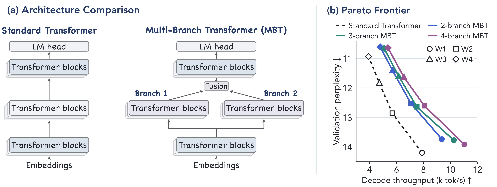
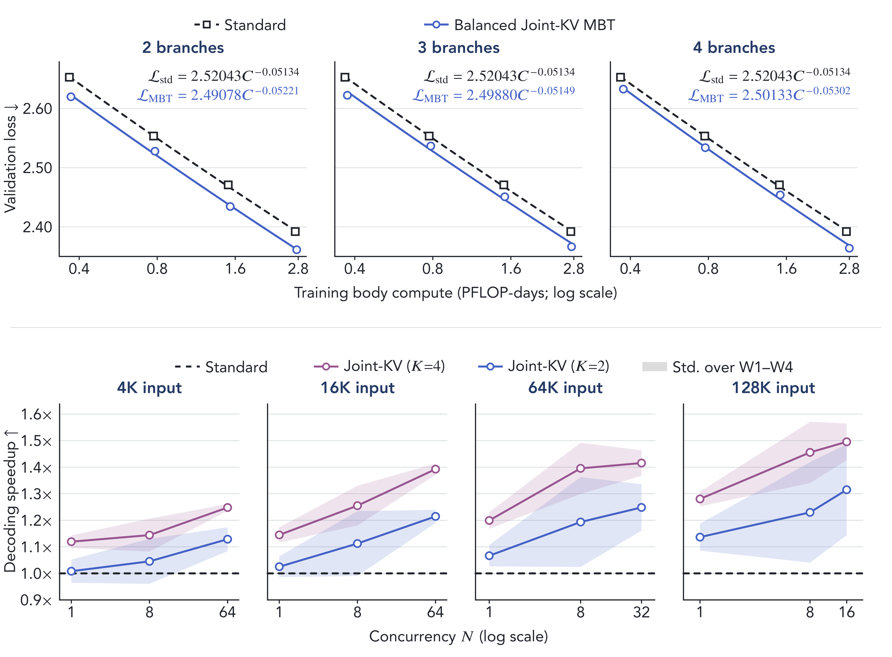
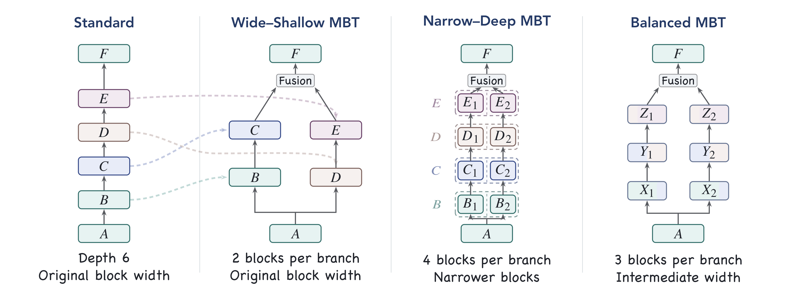

<p align="center">
  
</p>

<p align="center">
  <a href="https://gaotangli.github.io/project_page/Multi-Branch-Transformer/"></a>
  <a href="https://huggingface.co/collections/gaotang/multi-branch-transformer"></a>
  <a href="https://arxiv.org/abs/2611.19800"></a>
  <a href="https://arxiv.org/pdf/2611.19800"></a>
  <a href="https://x.com/GaotangLi/status/2122718169378730253"></a>
</p>

<p align="center">
  <a href="#overview">Overview</a> &nbsp;·&nbsp;
  <a href="#final-model-results">Results</a> &nbsp;·&nbsp;
  <a href="#getting-started">Getting started</a> &nbsp;·&nbsp;
  <a href="#training">Training</a> &nbsp;·&nbsp;
  <a href="#tests">Tests</a> &nbsp;·&nbsp;
  <a href="#resources">Resources</a>
</p>

## Overview

Transformers usually scale by making their blocks wider or stacking them deeper. **Multi-Branch Transformer (MBT)** explores a complementary path: **parallel composition of full Transformer blocks**.

Every token passes through shared initial blocks (**prelude**), independently parameterized **branches**, lightweight **fusion**, and shared final blocks (**coda**). Our final recipe combines **Balanced MBTs**, which jointly tune branch width and depth, with **Joint-KV**, which constructs one shared KV cache per branch depth while retaining branch-local queries.

<div align="center">
  <table align="center">
    <tr>
      <th align="center">Better scaling</th>
      <th align="center">Faster decoding</th>
    </tr>
    <tr>
      <td align="center"><strong>Up to 1.26×</strong><br>fitted training-body compute advantage</td>
      <td align="center"><strong>Up to 51.4%</strong><br>higher decoding throughput</td>
    </tr>
  </table>
</div>

Across four MoE scales (0.8B–2.1B), our final 2-, 3-, and 4-branch models all outperform their same-scale Standard reference in validation loss at comparable training compute.

<p align="center">
  <a href="assets/overview.svg"></a>
</p>

The frontier uses one H200, 16K input tokens, 1K output tokens, and 64 concurrent requests; validation perplexity is evaluated on held-out 4,096-token sequences. The maximum throughput gain above comes from a different serving setting, detailed below.

This repository contains **training code, explicit model implementations, W1–W4 configurations, and correctness tests**. Training uses Megatron's attention and latent MoE backend. The inference measurements use a dedicated serving implementation; the training launchers here do not benchmark decoding.

## Final model results

**Balanced + Joint-KV**, compared with Standard at each scale's training-data budget.

<p align="center">
  <a href="assets/final-model-results.svg"></a>
</p>

- **Scaling:** at validation loss 2.500, the fitted Standard curve requires up to **1.26×** the training-body compute of the final MBT curves. This is an equal-loss compute comparison, not a wall-clock training speedup.
- **Decoding:** averaged over W1–W4 on one H200, the final 4-branch MBTs decode **1.12–1.50×** as fast as Standard (1.01–1.32× with 2 branches), and the speedup grows with input length and concurrency. The **51.4%** peak gain is measured for W2 with 4 branches on one H200, with 64K input tokens, 1K output tokens, and 8 concurrent requests, against the same-scale Standard using the same serving engine.

See [final-model configurations and results](docs/final-models.md) for all 12 configurations, and the [scaling-only figure](assets/final-model-scaling.png) for the fitted equations. The maxima above need not occur in the same configuration.

## Architecture

<p align="center">
  <a href="assets/width-depth.svg"></a>
</p>

| Family | Branch width | Branch depth |
|:---|:---|:---|
| **Wide–Shallow** | Preserve the reference block width | Redistribute the middle blocks among branches |
| **Narrow–Deep** | Narrow the branch blocks | Preserve the reference sequential depth |
| **Balanced** | Intermediate width | Intermediate depth |

With independent KV, branches exchange no intermediate hidden states before fusion. With **Joint-KV**, branches exchange the information needed to form a shared cache at each depth. These are distinct execution patterns; Joint-KV does not mean sharing attention queries or reusing one cache across all depths.

See the [architecture guide](docs/architecture.md) for block allocation, dimensions, fusion, and KV sharing. To read the implementation, start with [MBTModel](code/mbt/modeling.py) and its [decoder](code/mbt/decoder.py).

## Getting started

```bash
git clone https://github.com/GaotangLi/Multi-Branch-Transformer.git
cd Multi-Branch-Transformer
```

Follow the [installation guide](docs/installation.md) to create a Python 3.12 environment on your large storage volume. Install the package and test dependencies:

```bash
python -m pip install -e '.[test]'
```

Configuration inspection does not import GPU libraries. Numerical decoder tests need PyTorch; a CPU build is sufficient. GPU training additionally requires CUDA-enabled PyTorch, Transformer Engine, FlashAttention, and the training dependencies described in the guide. The CUDA extensions must match your PyTorch/CUDA environment. Follow the [training-data guide](docs/data.md) to download FineWeb-Edu and the Llama 3 tokenizer, build indexed shards, and generate `data.json` before launching a run.

## Training

Inspect a W1 Balanced 2-branch Joint-KV run before allocating GPUs:

```bash
PYTHONDONTWRITEBYTECODE=1 PYTHONPATH=code python -m mbt.train \
  --config configs/w1/balanced-2-joint.json \
  --data-config /scratch/data.json \
  --output-dir /scratch/runs/w1-joint \
  --world-size 8 --expert-parallel-size 8 \
  --dry-run
```

Replace the example data and output paths with your own. The dry run resolves the model, optimizer schedule, data paths, and parallel layout; it does not launch training or certify GPU capacity.

On an allocated eight-GPU node, launch the same configuration with:

```bash
NPROC_PER_NODE=8 bash scripts/train.sh \
  --config configs/w1/balanced-2-joint.json \
  --data-config /scratch/data.json \
  --output-dir /scratch/runs/w1-joint \
  --temp-root /scratch/tmp \
  --expert-parallel-size 8
```

See the [training guide](docs/training.md) for validation, checkpoint/resume, logging, and the portable [Slurm example](scripts/slurm/train.sbatch). Each configuration states its branch allocation, dimensions, LR, and training budget. Keep checkpoints, logs, and compiler caches on large storage.

## Tests

Check configurations, launch contracts, accounting, and the production decoder's outputs and gradients on CPU:

```bash
PYTHONDONTWRITEBYTECODE=1 PYTHONPATH=code python -m unittest discover -s tests -p 'test_*.py' -v
```

Then exercise the explicit model with its native attention and MoE kernels on one allocated GPU:

```bash
MBT_TEST_ROOT=/scratch/test-unique \
MBT_TEMP_ROOT=/scratch/tmp \
bash scripts/check_native.sh
```

Use a fresh test output directory. The GPU check runs a small model through forward/backward and full optimizer-checkpoint save/resume. It is a correctness check; measure capacity with the intended model and distributed layout before a full run. An opt-in [reference parity test](docs/testing.md) compares identical weights against an externally supplied research implementation in isolated processes.

See the [validation record](docs/validation.md) for what has been checked in this source release.

## Resources

[Model checkpoints](https://huggingface.co/collections/gaotang/multi-branch-transformer) and the [fixed validation set](https://huggingface.co/datasets/gaotang/MBT-Validation) are available on Hugging Face. Checkpoints use Megatron-native model-only weights; see the [loading guide](utils/NATIVE_CHECKPOINTS.md), [validation guide](utils/VALIDATION.md), and [optional conversion utility](utils/checkpoint_conversion/README.md).

## Repository map

```text
code/
  mbt/
    modeling.py         Explicit MBTModel and attention–MoE block
    decoder.py          Prelude, branch execution, fusion, and coda
    attention.py        Joint-KV attention with branch-local queries
    modules.py          Width bridge, fusion, and shared-KV projection
    model.py            Model construction and configuration validation
    train.py            Portable training entry point
  backend/              Vendored Megatron backend with upstream license notices
configs/
  w1/ … w4/             Standard and MBT training recipes
  data.example.json     Portable dataset/tokenizer configuration
scripts/
  train.sh              torchrun launcher
  check_native.sh       Single-GPU correctness check
  slurm/train.sbatch    Cluster-neutral Slurm example
tests/                  CPU contracts and native GPU smoke
docs/                   Installation, data, training, and architecture guides
assets/                 Homepage figures and editable wordmark
```

## Citation

```bibtex
@article{li2026multi,
  title={Multi-Branch Transformer},
  author={Li, Gaotang and Chen, Lingjie and Deng, Chunyuan and Xu, Zhiwei and Chen, Hongzheng and De Sa, Christopher and He, Jingrui and Wang, Yingheng and Tong, Hanghang},
  journal={arXiv preprint arXiv:2611.19800},
  year={2026}
}
```

## Acknowledgments

Our training stack builds on [NVIDIA Megatron-LM](https://github.com/NVIDIA/Megatron-LM) and PyTorch. We thank their maintainers and the open-source community. Dataset, tokenizer, model, and third-party code licenses are documented separately from this repository's original contributions.

## License

Original code, documentation, and figures are licensed under [BSD-3-Clause](LICENSE). Bundled upstream code retains its original license and notices; see [third-party notices](THIRD_PARTY_NOTICES.md). Model weights, tokenizers, and datasets retain their respective licenses.
