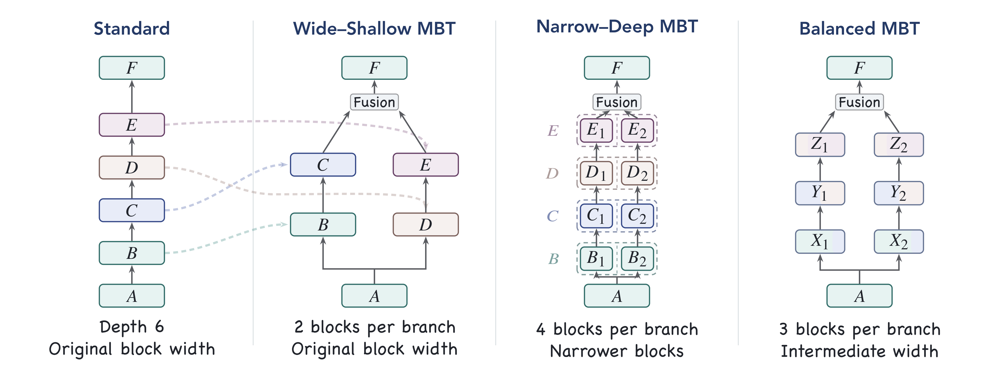
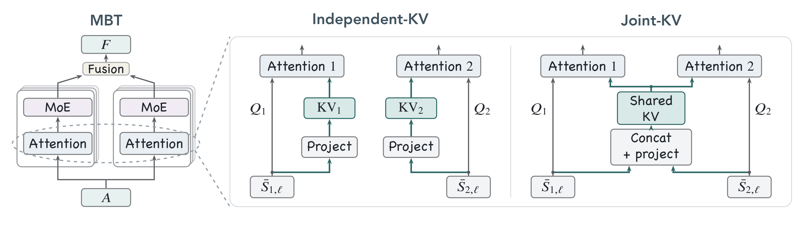

# Architecture guide

An MBT replaces a serial middle stack with parallel branches of full attention–MoE blocks. The shared initial and final stacks are called **prelude** and **coda**.

## Reading an allocation

`P / (L1 + L2 + … + LK) / C` specifies prelude depth, the depth of each of `K` branches, and coda depth. For example, `3 / (3 + 3) / 3` has 12 independently parameterized blocks and a depth of 9 blocks along either branch.

- **Physical block count:** `P + sum(Li) + C`.
- **Depth:** `P + max(Li) + C`.
- **Branch block ratio:** `sum(Li) / (P + sum(Li) + C)`.

These counts exclude the embedding, LM head, branch input projections, and fusion projection. The latter projections still contribute parameters and compute. Attention and MoE together form one block.

## Width–depth families



**Wide–Shallow** preserves the reference block width and distributes the middle blocks over branches. **Narrow–Deep** preserves depth and reduces the width of each branch. **Balanced** uses intermediate branch widths and depths. For a width-changing configuration, a shared normalization and linear projection map the prelude representation to branch width before the branches separate.

The three families describe the allocation of width and depth; branch count is a separate choice. They can be compared at approximately matched training compute, but equal block counts alone do not imply equal FLOPs or parameter counts.

### Dimension names

| Symbol | Meaning |
|:---|:---|
| `d` | Residual width |
| `m` | MoE latent width: the dimension used within the latent MoE |
| `f` | Hidden width of each SwiGLU expert |
| `K` | Number of branches |
| `P`, `C` | Prelude and coda block counts |
| `Li` | Number of blocks in branch `i` |

The shared blocks and branch blocks can have different `d/m/f` values. The Standard W1–W4 ladder uses `d:m:f = 2:1:1`; modified branch configurations state their dimensions explicitly.

## Fusion

At each token, RMS-normalize each branch output, concatenate along the channel dimension, and apply a bias-free linear projection to the shared width:

```text
z = concat(RMSNorm_1(h_1), …, RMSNorm_K(h_K))
fused = Linear(z)
output = coda(fused)
```

The projected result is the coda input. There is no additional residual addition of one branch to the fused result. This fusion is tokenwise: any mixing across sequence positions occurs in the attention blocks.

## Independent-KV and Joint-KV



**Independent-KV** gives every branch at every depth its own key and value projections and cache. The branches can execute independently until fusion.

**Joint-KV** combines the normalized branch representations at a given depth to produce one shared key and value representation. Each branch retains its own query and attention output projections, attention computation, residual stream, and MoE. Shared prelude and coda blocks retain their usual attention.

For equal-width, equal-depth branches, Joint-KV stores one branch cache per depth instead of `K`. This reduces **branch-region** KV storage by `1 − 1/K`. Full-model savings are smaller because shared outer blocks still store their own KV. Savings relative to a Standard Transformer also depend on branch depth and width; `1 − 1/K` is not a universal full-model saving.

Joint-KV introduces communication across branches at each depth. It preserves causal attention, and it is not equivalent to sharing one KV representation across every layer. Architectural branch parallelism alone does not guarantee a wall-clock speedup in the training runtime.

## Reading the code

The model graph is defined by ordinary modules and explicit forward calls:

| File | Responsibility |
|:---|:---|
| [`modeling.py`](../code/mbt/modeling.py) | `MBTModel` embeds tokens, calls its decoder, and applies the tied vocabulary head; `MBTBlock` implements the attention and MoE residual updates. |
| [`decoder.py`](../code/mbt/decoder.py) | `MBTDecoder` owns the prelude, branch stacks, optional width bridge, fusion, and coda. |
| [`modules.py`](../code/mbt/modules.py) | Normalized concat fusion, width projection, and the shared KV projection. |
| [`attention.py`](../code/mbt/attention.py) | `JointKVAttention` receives shared K/V explicitly and produces branch-local queries and gates. |
| [`model.py`](../code/mbt/model.py) | `build_model` validates the configuration and constructs the model. |

Independent branches execute as separate stacks. Joint-KV branches execute depth by depth: the decoder first normalizes **all** current branch states and forms their shared K/V, then advances each branch using that same pair. This ordering preserves the gradient paths from the shared K/V to every contributing branch.

The shared producer concatenates normalized branch inputs with a `1 / sqrt(K)` scale, applies its KV projection, and headwise-normalizes the keys. Each consumer applies causal attention and RoPE with its own queries. No cache or intermediate activation is hidden in process-global model state, and model construction does not replace a backend class's forward method.

## Scope of this release

The initial public code focuses on pretraining and correctness tests. Its checkpoints use the explicit module hierarchy and support strict full-state resume within that format. Historical model weights require a deliberate key conversion; they are not interchangeable optimizer checkpoints. The paper's inference results use a dedicated implementation of branch execution and shared-KV attention. A training forward pass or an architectural cache calculation is not an inference benchmark.
